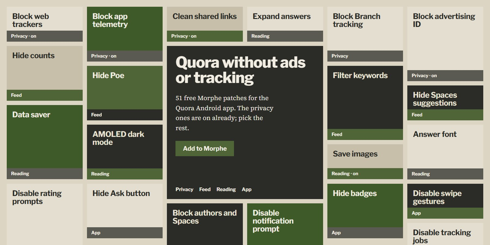

<p align="center">
  <a href="https://jofslash.github.io/quora-patches/"></a>
</p>

# Quora Patches for Morphe

**46 free patches for the [Quora](https://play.google.com/store/apps/details?id=com.quora.android) Android app**, applied with [Morphe](https://morphe.software).
They remove the ads, stop the app from tracking you, and let you hide the parts of Quora you don't want.
The privacy patches are on by default; the rest are yours to pick.

<a href="https://morphe.software/add-source?github=JoFSlash/quora-patches"></a>

🌐 [Website](https://jofslash.github.io/quora-patches/) · 📦 [Releases](https://github.com/JoFSlash/quora-patches/releases) · 🐞 [Report a problem](https://github.com/JoFSlash/quora-patches/issues/new/choose)

## 🛡️ Privacy and tracking

On by default. They change nothing you see.

| Patch | What it does |
| --- | --- |
| **Remove ads** | Hides promoted answers, sponsored posts and Google ads, and blocks requests to ad servers. |
| **Disable analytics** | Turns off Firebase Analytics, Crashlytics, Firebase Performance and Facebook app events. |
| **Block web trackers** | Blocks third-party analytics and tracking requests from Quora's pages. |
| **Block app telemetry** | Drops the app's own usage logs: reading time, tab presses, experiments, app speed, errors. |
| **Block tracking logs** | Stops the pages passing performance and sign-up tracking events to the app. |
| **Disable tracking jobs** | Stops the hourly charging-status job and the daily notifications-status job. |
| **Block advertising ID** | Stops the app sending your advertising ID and Android ID to Quora. |
| **Block clipboard reading** | Pages can no longer read what you copied. Pasting still works. |
| **Disable WebView debugging** | The app turns this on for every page; the patch turns it off. |
| **Clean shared links** | Removes tracking parameters from links you copy or share. |
| **Spoof installer** | Reports Google Play as the installer. |
| **Block Branch tracking** *(optional)* | Puts Branch, the install-tracking SDK, in its "disable tracking" mode. |

## 📰 Feed and answers

Off by default, because they change what Quora shows you.

| Patch | What it does |
| --- | --- |
| **Hide Quora+ answers** · **Hide Quora+ promotions** | Hides paywalled answers and the "Try Quora+" buttons. |
| **Hide AI answers** · **Hide Poe** | Hides answers by Poe bots and the links to Poe and the assistant. |
| **Hide related questions** · **Hide suggested questions** · **Hide Spaces suggestions** | Hides those lists and feed units. |
| **Hide counts** · **Hide downvote button** | Hides upvote, view and share counts, and the downvote button. |
| **Disable video autoplay** | Videos play only when you tap them. |
| **Enable text selection** | Lets you select and copy text on every page. |
| **Text size** | Larger or smaller text, 85–150% (option). |
| **Filter keywords** · **Block authors and Spaces** | Hides answers and posts that mention your words, or come from people and Spaces you list (options). |
| **Expand answers** | Opens shortened answers in full, no "(more)" tap. |
| **Hide people suggestions** | Hides "People you may know" in the feed. |
| **Comfortable reading** · **Answer font** | More line spacing; answers in a serif or sans-serif font (option). |
| **AMOLED dark mode** | Pure black background with Quora's dark theme. |
| **Data saver** | Images load only when you tap them. |

## 📱 The app

The three prompt patches are on by default; the rest are optional.

| Patch | What it does |
| --- | --- |
| **Disable update prompts** · **Disable rating prompts** · **Disable notification prompt** | No Play Store update screen, no rating requests, no notification permission prompt. |
| **Disable sign-in prompts** | No "Save password?" or automatic Google sign-in. |
| **Hide tabs** · **Start tab** | Remove bottom bar tabs and pick the one the app opens on (options). |
| **Hide badges** | Hides the red dots and counts on the tabs. |
| **Open links in browser** | Opens other websites in your browser instead of an in-app tab. |
| **Disable vibration** · **Disable tab prefetching** | No vibration on taps; other tabs load only when opened. |
| **Block promotional notifications** | Drops digests and promotions; notifications about you still arrive. |
| **Disable swipe gestures** | No pull to refresh or sideways swiping between feeds (options). |
| **Hide Ask button** · **Keep screen on** | No Ask button; the screen stays on while you read. |

## 📲 Install

1. Install [Morphe Manager](https://morphe.software).
2. Tap **[Add to Morphe](https://morphe.software/add-source?github=JoFSlash/quora-patches)**, or add `https://github.com/JoFSlash/quora-patches` as a patch source.
3. Pick Quora. Morphe downloads a supported version (3.2.42 or 3.2.30 from [APKMirror](https://www.apkmirror.com/apk/quora-inc/quora/)) and applies the patches you ticked.
4. Uninstall the Play Store Quora, then install the patched app and sign in.

No root needed. The patched app is signed with a different key, which is why the Play Store version has to go first.

## 🩹 Full patch list

Generated from the latest release, with each patch's options and supported versions.

<!-- PATCHES_START EXPANDED -->
> **[v1.2.0-dev.2](https://github.com/JoFSlash/quora-patches/releases/tag/v1.2.0-dev.2)**&nbsp;&nbsp;•&nbsp;&nbsp;`dev`&nbsp;&nbsp;•&nbsp;&nbsp;31 patches total
<details open>
<summary>📦 Quora&nbsp;&nbsp;•&nbsp;&nbsp;31 patches</summary>
<br>

**Package name:** `com.quora.android`

**🎯 Supported versions:**

| 3.2.42 | 3.2.30 |
| :---: | :---: |

| 💊&nbsp;Patch | 📜&nbsp;Description | ⚙️&nbsp;Options |
|----------|----------------|-----------|
| [Block advertising ID](#block-advertising-id) | Stops the app from sending your advertising ID and Android ID to Quora. |  |
| [Block app telemetry](#block-app-telemetry) | Stops the app from sending usage logs to Quora, such as reading time, tab presses, experiments, app speed and errors. |  |
| [Block clipboard reading](#block-clipboard-reading) | Stops Quora's pages from reading what you copied. Pasting with the keyboard still works. |  |
| [Block tracking logs](#block-tracking-logs) | Stops Quora's pages from passing performance and sign-up tracking events to the app. |  |
| [Block web trackers](#block-web-trackers) | Blocks requests from Quora pages to third-party analytics and tracking services. |  |
| [Clean shared links](#clean-shared-links) | Removes tracking parameters from Quora links you copy or share. |  |
| [Disable WebView debugging](#disable-webview-debugging) | Stops the app from letting a connected computer inspect its pages, which would show your account's cookies. |  |
| [Disable analytics](#disable-analytics) | Turns off Firebase Analytics, Crashlytics, Firebase Performance and Facebook app events, and stops the advertising ID from being collected. |  |
| [Disable charging tracking](#disable-charging-tracking) | Stops the hourly job that tells Quora whether your phone is charging. |  |
| [Disable notification prompt](#disable-notification-prompt) | Stops the app from asking for permission to show notifications. You can still turn notifications on in Android's settings. |  |
| [Disable rating prompts](#disable-rating-prompts) | Stops the app from asking you to rate it on Google Play. |  |
| [Disable update prompts](#disable-update-prompts) | Stops the app from showing the Google Play update screen. |  |
| [Disable vibration](#disable-vibration) | Stops the app from vibrating when you tap buttons such as upvote. |  |
| [Disable video autoplay](#disable-video-autoplay) | Videos in the feed and in answers only play when you tap them. |  |
| [Enable text selection](#enable-text-selection) | Lets you select and copy text on every page. |  |
| [Hide AI answers](#hide-ai-answers) | Hides answers written by Poe bots. |  |
| [Hide Poe](#hide-poe) | Hides links and buttons that open Poe or Quora's AI assistant. |  |
| [Hide Quora+ answers](#hide-quora-answers) | Hides answers and posts that can only be read with a Quora+ subscription. |  |
| [Hide Quora+ promotions](#hide-quora-promotions) | Hides buttons that ask you to try or join Quora+. |  |
| [Hide Spaces suggestions](#hide-spaces-suggestions) | Hides the Spaces you might like suggestions in the feed. |  |
| [Hide badges](#hide-badges) | Hides the red dots and counts on the bottom bar tabs. |  |
| [Hide counts](#hide-counts) | Hides upvote, view and share counts on answers and posts. |  |
| [Hide downvote button](#hide-downvote-button) | Hides the downvote button on answers and posts. |  |
| [Hide related questions](#hide-related-questions) | Hides the related questions lists on question pages. |  |
| [Hide suggested questions](#hide-suggested-questions) | Hides the questions for you to answer in the feed. |  |
| [Hide tabs](#hide-tabs) | Removes the tabs you pick from the bottom bar. Home always stays. | • Hide Following tab<br>• Hide Answer tab<br>• Hide Spaces tab<br>• Hide Notifications tab |
| [Open links in browser](#open-links-in-browser) | Opens links to other websites in your default browser instead of an in-app browser tab. |  |
| [Remove ads](#remove-ads) | Hides promoted answers, sponsored posts and Google ads in the feed and on question pages, and blocks requests to ad servers. |  |
| [Spoof installer](#spoof-installer) | Reports Google Play as the app installer, so Quora does not treat the patched app as installed from an unknown source. |  |
| [Start tab](#start-tab) | Opens the app on the tab you pick instead of Home. | • Start tab |
| [Text size](#text-size) | Makes the text on every page larger or smaller. | • Text size |

</details>

<!-- PATCHES_END -->

## 🧑‍💻 Building

Requires JDK 21 and a GitHub token with `read:packages` (see the [Morphe docs](https://github.com/MorpheApp/morphe-documentation/blob/main/docs/morphe-development/1_setup.md)).

```bash
./gradlew buildAndroid
```

The bundle is written to `patches/build/libs/patches-*.mpp`.

## 📜 License

These patches are licensed under the [GNU General Public License v3.0](LICENSE). See [NOTICE](NOTICE).
This project is not affiliated with Quora or with the Morphe project.
