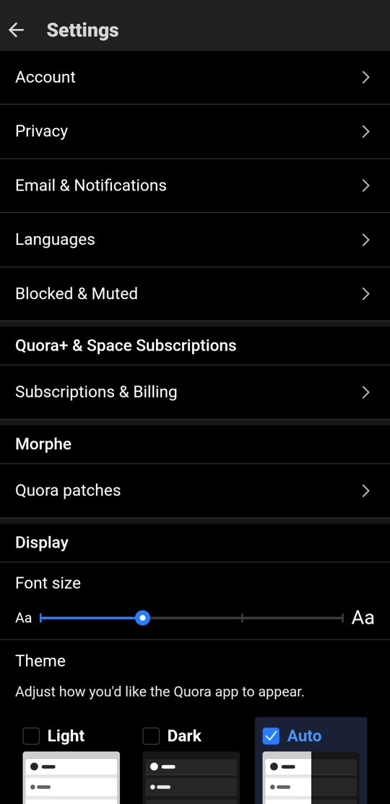
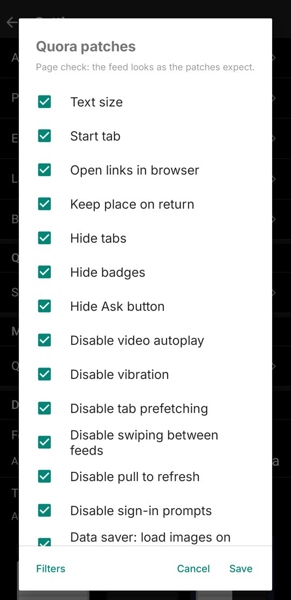

# Quora patches for Morphe

Patches for the [Quora](https://play.google.com/store/apps/details?id=com.quora.android) Android app, applied with
[Morphe](https://morphe.software). They remove ads and tracking, and let you hide the parts of Quora you don't use:
AI answers, Quora+ paywalls, suggestions, counts, old answers and so on.

The privacy patches are on by default. Everything else is off until you pick it.

<p>
  
  
</p>

## Install

1. Install Morphe Manager from [morphe.software](https://morphe.software).
2. Add this repository as a patch source: open
   [this link](https://morphe.software/add-source?github=JoFSlash/quora-patches) on your phone, or add
   `https://github.com/JoFSlash/quora-patches` under sources in Morphe Manager.
3. Pick Quora and the patches you want. Morphe downloads a supported version from
   [APKMirror](https://www.apkmirror.com/apk/quora-inc/quora/) and patches it.
4. Uninstall the Play Store version before installing the patched one. It is signed with a different key,
   so Android won't install it over the original. No root needed.

## Changing patches later

Most patches can be switched on and off in the app without patching again: open **Settings > Morphe > Quora
patches**, or long-press the **Home** tab. The same dialog edits the keyword and author filters, backs up your
settings as text, and tells you when Quora has changed its pages in a way that breaks some patches.

## Patches

<!-- PATCHES_START -->
Version 1.4.0, 56 patches. Supported Quora versions: 3.2.42, 3.2.30.

### Privacy

On by default. They stop data collection and change nothing you see.

| Patch | Default | What it does |
| --- | --- | --- |
| Block Branch tracking | off | Turns on Branch's "disable tracking" mode and turns off its debug mode. Branch tracks where installs come from. Quora's quora.app.link links may open with less detail. |
| Block advertising ID | on | Stops the app from sending your advertising ID and Android ID to Quora. |
| Block app telemetry | on | Stops the app from sending usage logs to Quora, such as reading time, tab presses, experiments, app speed and errors. |
| Block clipboard reading | on | Stops Quora's pages from reading what you copied. Pasting with the keyboard still works. |
| Block tracking logs | on | Stops Quora's pages from passing performance and sign-up tracking events to the app. |
| Block web trackers | on | Blocks requests from Quora pages to third-party analytics and tracking services. |
| Clean shared links | on | Removes tracking parameters from Quora links you copy or share. |
| Disable WebView debugging | on | Stops the app from letting a connected computer inspect its pages, which would show your account's cookies. |
| Disable analytics | on | Turns off Firebase Analytics, Crashlytics, Firebase Performance and Facebook app events, and their advertising ID collection. |
| Disable tracking jobs | on | Stops the background jobs that tell Quora every hour whether your phone is charging and every day whether notifications are on. |
| Remove ads | on | Hides promoted answers, sponsored posts and Google ads in the feed and on question pages, and blocks requests to ad servers. |
| Spoof installer | on | Reports Google Play as the app installer, so Quora does not treat the patched app as installed from an unknown source. |

### Feed

What the feed and question pages show.

| Patch | Default | What it does |
| --- | --- | --- |
| Block authors and Spaces | off | Hides answers and posts by the people and Spaces you pick. Options: Authors and Spaces. |
| Filter keywords | off | Hides answers, posts and questions that mention words you pick. Options: Keywords. |
| Hide AI answers | off | Hides answers written by Poe bots. |
| Hide Follow buttons | off | Hides the small "Follow" next to author and Space names. Profiles and Space pages keep theirs. |
| Hide Poe | off | Hides links and buttons that open Poe or Quora's AI assistant. |
| Hide Quora+ answers | off | Hides answers and posts that can only be read with a Quora+ subscription. |
| Hide Quora+ promotions | off | Hides buttons that ask you to try or join Quora+. |
| Hide Spaces posts | off | Hides posts from Spaces in the feed, so it shows answers to questions only. |
| Hide Spaces suggestions | off | Hides the Spaces you might like suggestions in the feed. |
| Hide comment previews | off | Hides the "123 comments from … and more" row under answers. Comments still open from the comment button. |
| Hide counts | off | Hides upvote, view and share counts on answers and posts. |
| Hide credentials | off | Hides the line under authors' names, such as "Lives in Vienna", and "Upvoted by" lines. The date stays. |
| Hide downvote button | off | Hides the downvote button on answers and posts. |
| Hide old answers | off | Hides answers and posts older than the number of years you pick, in the feed and on question pages. Options: Older than. |
| Hide people suggestions | off | Hides "People you may know" and other people to follow in the feed. |
| Hide related questions | off | Hides the related questions lists on question pages. |
| Hide seen items | off | Dims or hides feed items you already opened when the feed shows them again. The list of opened items stays on your phone. Options: Seen items. |
| Hide suggested questions | off | Hides the questions for you to answer in the feed. |
| Hide surveys | off | Hides Quora's surveys in the feed, such as "How satisfied are you with your home feed?". |

### Reading

How answers look and load.

| Patch | Default | What it does |
| --- | --- | --- |
| AMOLED dark mode | off | Uses a pure black background when Quora's dark theme is on. |
| Answer font | off | Sets answers in a serif or a sans-serif font of your phone. Options: Font. |
| Comfortable reading | off | More space between the lines and paragraphs of answers. |
| Data saver | off | Images load only when you tap them. By default only on mobile data; on Wi-Fi they load as usual. Options: Load images on Wi-Fi. |
| Disable video autoplay | off | Videos in the feed and in answers only play when you tap them. |
| Enable text selection | off | Lets you select and copy text on every page. |
| Expand answers | off | Opens shortened answers on question pages, and shows the whole answer preview in the feed. |
| Keep screen on | off | Keeps the screen from turning off while a page is open. |
| Save images | on | Long-press an image you opened full screen to save it to Pictures/Quora. |
| Text size | off | Makes the text on every page larger or smaller. Options: Text size. |

### App

The app around the pages: prompts, tabs, notifications, gestures.

| Patch | Default | What it does |
| --- | --- | --- |
| Block promotional notifications | off | Drops digest and promotional push notifications. Replies, comments and other notifications about you still arrive. |
| Disable notification prompt | on | Stops the app from asking to show notifications, both its own prompt and Android's. You can still turn notifications on in Android's settings. |
| Disable rating prompts | on | Stops the app from asking you to rate it on Google Play. |
| Disable sign-in prompts | off | Stops Google's "Save password?" and automatic Google sign-in prompts. You can still sign in with the buttons on the login page. |
| Disable swipe gestures | off | Turns off pulling down to refresh and swiping sideways between feeds, so a page doesn't reload or change while you read. Options: Disable pull to refresh, Disable swiping between feeds. |
| Disable tab prefetching | off | Saves data by loading the other tabs only when you open them. |
| Disable update prompts | on | Stops the app from showing the Google Play update screen and the feed's update card. |
| Disable vibration | off | Stops the app from vibrating when you tap buttons such as upvote. |
| Hide Ask button | off | Hides the button for asking a question in the top bar and on pages. |
| Hide badges | off | Hides the red dots and counts on the bottom bar tabs. |
| Hide tabs | off | Removes the tabs you pick from the bottom bar. Home always stays. Options: Hide Following tab, Hide Answer tab, Hide Spaces tab, Hide Notifications tab. |
| Keep place on return | off | Keeps open answers and your place in the feed when you come back to the app, instead of closing them and reloading the feed. |
| Open links in browser | off | Opens links to other websites in your default browser instead of an in-app browser tab. |
| Patch settings | on | Long-press the Home tab, or open Settings > Morphe > Quora patches, to switch the page patches on and off and edit the filters, without patching again. It also tells you when Quora changes its pages so that some patches stop working. |
| Start tab | off | Opens the app on the tab you pick instead of Home. Options: Start tab. |
<!-- PATCHES_END -->

## Known issues

- Most patches work on Quora's web pages, which can change without a new app version. When that happens,
  a patch stops working without any error. The page check in the settings dialog catches the common cases.
- With Data saver, tapping an image placeholder in the feed opens the post instead of loading the image.
  The image loads when you tap it there.
- Hide Quora+ answers and Hide surveys haven't been tried on a real paywalled answer or survey yet.

Something else wrong? [Open an issue](https://github.com/JoFSlash/quora-patches/issues/new/choose).

## Building

You need JDK 21 and a GitHub token with `read:packages`
(see the [Morphe docs](https://github.com/MorpheApp/morphe-documentation/blob/main/docs/morphe-development/1_setup.md)).

```bash
./gradlew buildAndroid
```

The bundle ends up in `patches/build/libs/patches-*.mpp`. [CONTRIBUTING.md](CONTRIBUTING.md) explains how the
patches are put together and how to check a new Quora version.

## License

[GPL-3.0](LICENSE), see also [NOTICE](NOTICE). Not affiliated with Quora or with the Morphe project.
